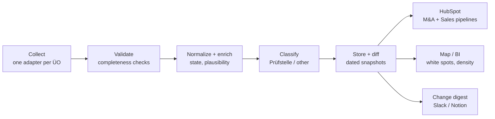

# Prüfstellen Sourcing — Project Plan

> **Status:** Phase 1/2 in progress. GTÜ: adapter built, full run passed 2026-09-30, post-run verification pending. **DEKRA: adapter built and working, full run passed 2026-10-05 (826 in scope).** **KÜS: adapter built 2026-10-05 (fixed-radius coverage proof, simulated and sample runs pass), first full run pending.** All other sources not started.
> **Snapshot:** Oct 5, 2026
> **Companion context:** HolDeinePlakette Primer, HolDeinePlakette M&A Primer, **Scraper Status** (`scraper_status.md`, live per-source state). This plan describes goals, rules and architecture; per-source findings live in the Scraper Status file.

---

## 1. Goal

Build a **complete, deduplicated list of every vehicle inspection station (Prüfstelle) in Germany**, across all recognized Überwachungsorganisationen (ÜOs): the regional TÜV companies, DEKRA, GTÜ, KÜS, and affiliated networks such as FSP. The list is refreshed on a schedule, comes with a change report, and can be imported into HubSpot.

**Scope decision (management, 2026-09-28):** only **actual Prüfstellen** are in scope, i.e. locations where inspections take place at the listed address. **Prüfstützpunkte (PSPs) in workshops and dealerships are out of scope** for all ÜOs.

**DEKRA exception (Nikos / management, 2026-10-05):** "better 200 records too many than 3 missing". DEKRA has no explicit Prüfstelle flag, so every record that passes a plain scope rule (German, Automobil-typed, or untyped with a vehicle-site name) is included **without validation first**; doubtful records (PSP-like, thin, untyped) are only flagged. Validation happens later, after inclusion in the competitor map, which is not part of this project for now.

Scrapers still collect **everything a source lists** (e.g. engineering offices without their own station). That's needed to prove completeness against the source's own totals. Filtering to Prüfstellen happens at export (`in_scope` column).

**Who uses it**

| Team | Use |
|---|---|
| M&A (SL) | Sourcing pool for the *M&A Outbound / Nachfolge* pipeline. KÜS partners and owner-run bureaus are prime targets. Later: closures and changes as succession signals. |
| Expansion | White-spot and density analysis: where there is no or thin Prüfstellen coverage; distance to the nearest competing station. |
| Sales | Competitive picture: which Prüfstellen operate near our sites and customers. |

**Constraints**

1. **Free (strong preference).** No new paid tools, APIs or hosting. APIs and MCP connectors already included in our existing plans are fine, e.g. Claude MCP connectors or HubSpot's API within our current tier. Free open data (e.g. GeoNames, CC BY 4.0) is fine with attribution.
2. **Easy to export to HubSpot.** The output goes into HubSpot via native CSV import, with no custom integration.
3. **Simple.** Runnable by one person in VS Code with Claude Code. Logic lives in Python modules; a Jupyter notebook per source is the manual control panel.

---

## 2. Target process (to-be)

| Step | What it does | How (current plan) |
|---|---|---|
| **Collect** | Pull all locations from each ÜO's public locator. | One adapter per ÜO (`1_scrapers/<slug>/src/`), using the locator's own JSON API wherever one exists. For radius-capped locators: the shared adaptive grid (`2_core/grid.py`). |
| **Validate** | Prove the collection is complete; fail loudly otherwise. | Per query: source-reported totals (e.g. GTÜ's `MaxCount`). Per run: collected count vs. source total, drop vs. last run (>10% → alert), coverage warnings. |
| **Normalize + enrich** | Unify fields, add Bundesland, check coordinates against the PLZ, merge duplicates across sources. | `2_core/enrich.py` (state + plausibility from GeoNames), dedupe across ÜOs later. |
| **Classify** | Tag each row `pruefstelle` / `partner_office` / `unknown` and set `in_scope`. | From the source's own fields wherever possible (GTÜ: explicit flag). Rule-based signals only where a source has none. Unclear rows → `needs_review`. |
| **Store + diff** | Keep every run as a dated snapshot and compare with the previous one. | Dated run folders in each ÜO's `output/` and monthly files in `3_master_output/`, plus a diff script (Phase 3). Our own diff is required: source timestamps are not reliable (GTÜ's are batch dates). |
| **HubSpot** | Create new companies, update existing ones. | Native CSV import (Contacts & Companies → Import). |
| **Map / BI** | Coverage maps and density per region. | Google Sheet → Looker Studio (both free, already in the stack). |
| **Change digest** | Monthly summary of new, closed and changed Prüfstellen and what they mean for M&A and Expansion. | Claude or a Cowork task reading the diff file. |

**Principles**

- **Deterministic code does the extraction.** Claude builds the adapters, handles fuzzy edge cases (classification, duplicate matching) and writes the reporting. No agent clicks through websites on every run.
- **Investigate before coding.** For each ÜO, first find out how its locator works and report the approach before writing the adapter.
- **Completeness beats elegance; silent failure is the worst outcome.** Every adapter must be able to tell when it got less than it should have.
- **Known gaps get stated, not hidden.** Recorded per source in the Scraper Status file.

---

## 3. First big output goal: master CSV v1

**Deliverable:** `output/pruefstellen_master_YYYY-MM.csv` (plus an `.xlsx` copy), one row per physical inspection location in Germany, across all source orgs, filterable to in-scope Prüfstellen.

### Definition of done

- [ ] All in-scope sources collected (see §4), each with a passing completeness check and row counts logged.
- [ ] Duplicates merged. The same address listed by two orgs or twice by one org becomes one row with multiple sources. Different sites of the same operator stay separate rows.
- [ ] Every row has `site_type`, `in_scope` and `site_type_evidence`.
- [ ] Review list (`needs_review` rows) cleared, or explicitly deferred.
- [ ] Spot-check of at least one region per source against an independent source (e.g. Google Maps).
- [ ] Test import of a sample (~50 rows) into HubSpot succeeded, with the column mapping documented.
- [ ] Short summary: totals per org, per type and per federal state.

### CSV schema

The schema is fixed (37 columns, see `2_core/master_schema.py::MASTER_COLUMNS`). The master is CSV only (`;`, `.`, UTF-8 BOM, IDs and PLZ as text); there is no Excel copy. One row per physical site, `master_id` = `PS-000001`, stable across months and **never dropped**: a site that no source lists any more stays in the master with `status = retired` and `retired_on` (retired after one missed month, only when its sources have fresh inputs; it returns under the same id if it reappears). `needs_review` is True only for rows retired or reactivated in the current run; everything else that is in doubt is a token in `doubt_flags`. Details: `scraper_status.md`, item "Master lifecycle".

The table below is the older candidate set of the source adapters, kept for reference; `master_schema.py` is authoritative.

| Column | Example | Notes |
|---|---|---|
| `location_id` | `GTUE-166591000` | **Our own stable ID**: source prefix plus source ID. Used for HubSpot dedupe. |
| `source_org` | `GTÜ` | TÜV SÜD / TÜV NORD / … / DEKRA / GTÜ / KÜS / FSP |
| `source_id` | `166591000` | ID as it appears in the source data. Stored as **text** (leading zeros matter). |
| `name` | `GTÜ KFZ Prüfstelle Trudering` | As listed. |
| `name_addon`, `name_addon2` | `Inh. Roland Wolf`, `Prüfstelle Aubing` | Addon lines. Addon 2 often holds the site label that separates an operator's sites. |
| `street`, `zip`, `city`, `country`, `state` | `Drosselweg 23`, `81827`, `München`, `D`, `Bayern` | Street includes the house number. `state` filled from GeoNames by PLZ. |
| `lat`, `lng` | `48.12`, `11.66` | From the source; `plz_distance_km` checks them against the PLZ centroid. |
| `phone`, `mobile`, `email`, `website` | | Where visible. |
| `booking_url`, `source_profile_url` | | Where visible. The GTÜ adapter currently names the profile link `gtue_profile_url`; to be generalized with the final schema. |
| `opening_hours` | `Mo–Fr 8–17` | Raw text. |
| `services` | `Hauptuntersuchung Pkw; …` | Semicolon-joined, where the source lists them. |
| `site_type` | `pruefstelle` | `pruefstelle` / `partner_office` / `unknown` |
| `site_type_evidence` | `herkunft:E; code:GTUP; text:yes` | Why we decided. |
| `in_scope` | `true` | `site_type == pruefstelle` |
| `needs_review`, `needs_review_reason` | `true`, `coordinate far from PLZ` | Rows for a human check. |
| `plz_distance_km` | `1.4` | Distance from the coordinates to the PLZ centroid. > 25 km → review. |
| `is_hdp_site` | | Always empty (filled only from an optional reference file that does not exist; renamed from `is_liria_site` on 2026-10-08). HolDeinePlakette's (HDP) own sites are collected by the HDP scraper and removed from the master by the aggregator (`2_core/hdp_removal.py`), so they aren't counted as competition. |
| `hubspot_record_id` | | Empty on first import, filled from the HubSpot export afterwards. |
| `first_seen`, `last_seen` | `2026-10-01` | For change detection from Phase 3. |
| `scraped_at` | `2026-10-01T09:00` | |

**File format:** CSV with `;` separator, `.` decimal mark, UTF-8 with BOM. This is the machine-readable master for HubSpot and the pipeline. An `.xlsx` copy (IDs and PLZ as text, coordinates as numbers) is for opening in Excel. **Don't save the CSV from Excel**: it drops leading zeros.

Raw source payloads are kept in each run's `raw.jsonl` so we can re-parse without re-scraping.

---

## 4. Source inventory

Filled in per source during investigation. Details (endpoints, fields, gaps, open issues) are in the Scraper Status file.

**To do first:** verify the complete current list of recognized ÜOs performing HU against an authoritative source. The list below is from the project brief.

| Source | Access method | Prüfstelle flag in source? | Approx. count | Status |
|---|---|---|---|---|
| GTÜ | **B + C**: JSON API (SmartMaps) behind an address search; max. 20 results per query, no paging → adaptive grid over PLZ points, completeness proved by a reference query (Niederdorla, 500 km) | **Yes**: branch code `GTUP` ("Prüfung vor Ort"), cross-checked with hidden `Herkunft` E/G | Reference `MaxCount` 1,429 = German total (the server caps the radius at 500 km; none of the collected entries is abroad); 855 Prüfstellen, 483 partner offices, 91 unknown | 🛠 adapter built; full run 2026-09-30 PASS; verification open |
| KÜS | **B + C**: JSON API on `webservice.kues.de` (`/api/kues/partnersuche?plz=<PLZ>`), no key, no cookies; every Partner within a **fixed 50 km** of the PLZ, no count field, no paging → completeness proved by four rules on the actual server centres (`2_core/radius_cover.py`), about 350 PLZ queries instead of 8,300 | **Yes**: `pruefungvorortmoeglich` (1 = the engineer inspects at this address); 0 = partner office, out of scope (decision 2026-10-05) | Not known before the first full run. The 80636 sample: 33 of 83 within 50 km have flag 1. "rund 400 eigene Prüfstellen" is an unverified snippet; "über 1.800 Prüfingenieure" is published (people, not sites) | 🛠 adapter built; simulated PASS, sample run equals the recon; full run pending; HDP's own sites are removed by the aggregator (HDP scraper), no reference file needed |
| DEKRA | **B**: map-bounds JSON API (`POST /api/locations/fromBoundaries`), no key; the whole map comes back in one request, no cap seen; completeness proved by comparing the world box, Germany box and 4 quarters by record id | **No.** Scope rule on type and name instead (see DEKRA exception in §1); all matches included, doubts flagged | 3,017 records in the universe, 1,723 DE, **826 in scope** (796 Automobil-typed + 30 untyped/AT-typed); DEKRA publishes "über 600" | ✅ adapter working; full runs 2026-10-05 PASS |
| FSP | TBD | TBD | TBD | 🔍 confirm affiliation / whether it's a separate source |
| TÜV SÜD | TBD | TBD | TBD | 🔍 |
| TÜV NORD | TBD | TBD | TBD | 🔍 |
| TÜV Rheinland | TBD | TBD | TBD | 🔍 |
| TÜV Hessen | TBD | TBD | TBD | 🔍 |
| TÜV Thüringen | TBD | TBD | TBD | 🔍 |
| TÜV Saarland | TBD | TBD | TBD | 🔍 |

**Access method types**

- **A — Embedded dataset.** The full list sits in the page source (script tag / JSON object). One request, parse the data.
- **B — Hidden JSON endpoint.** The locator loads results from an API endpoint. Find it in DevTools → Network → Fetch/XHR. Consuming that JSON is far more stable than parsing HTML.
- **C — Location search (PLZ / radius).** The site only answers "what's near X", often with a result cap. Don't loop over all ~8,300 PLZ: use the shared **adaptive grid** (`2_core/grid.py`), which splits areas until every query is provably complete (needs a source-reported total per query, or another way to detect a capped result).
- **D — HTML only.** Parse rendered pages. Use a headless browser (Playwright) only if content is JavaScript-rendered and no endpoint exists.

**Recon checklist per source:** find the endpoint · auth (keys, headers, origin) · result cap and paging · does the response report totals? · stable ID · Prüfstelle vs. other entries · national total to validate against · published figures to sanity-check against.

---

## 5. Classifying Prüfstellen

The question per row is: **is this an actual inspection station at this address?** (`site_type` → `in_scope`).

**Order of preference**

1. **The source's own fields.** Explicit flags or codes beat any heuristic. GTÜ: branch code `GTUP` = "GTÜ-Ingenieurbüro mit amtlicher Fahrzeugprüfung vor Ort" → Prüfstelle (assumption accepted by management, 2026-09-28). Codes are preferred over display text, with the text as a cross-check.
2. **Cross-checks within the source.** If two signals disagree (e.g. GTÜ's code vs. `Herkunft`), the row becomes `unknown` + `needs_review`. Never guess silently.
3. **Rule-based signals**, only for sources without an explicit flag, weighted and tested on a hand-labeled sample:
   - the source's own labels ("Prüfstelle", "Station", "Prüfzentrum" vs. "Büro", "Partner")
   - the name is the ÜO's own branding vs. an engineering office or a workshop/dealer name
   - the same address listed by several orgs
   - opening hours are **weak** evidence: GTÜ Prüfstellen can say "Prüfzeiten nach Vereinbarung"

**DEKRA (decided 2026-10-05).** No classification step: the source has no flag and a hand-labelled sample (86 rows) showed that almost every Automobil-typed German record performs HU (70 of 74), including person-named partner offices (12/12), while the text signals (booking link, HU mention) only prove "yes", never "no". Therefore all records passing the scope rule are in scope; `doubt_flags` marks untyped / AT-typed, thin (possibly closed), PSP-like and "no vehicle testing" records and the non-DEKRA operator, for the later validation.

**KÜS (decided 2026-10-05).** The source has an explicit flag, so it is rule 1: `pruefungvorortmoeglich` = 1 → `pruefstelle`, in scope; 0 → `partner_office` (the engineer inspects at PSPs, not at this address), out of scope. Conflicts with the name (Prüfstelle / KÜS-Team with flag 0) or the address (flag 1 without street or coordinates) are flagged for review, never overruled; everything is collected and filtered only by `in_scope`. Whether the flag misses real Prüfstellen is checked on the full run (pattern analysis in `sources/kues.md`).

**Validation**

- Compare Prüfstellen counts against the ÜO's own published figures (GTÜ: "700+ / ~800 own Prüfstellen").
- For rule-based sources: hand-label ~50–100 known locations (including HolDeinePlakette's own sites) as ground truth and check accuracy before relying on the score.

---

## 6. HubSpot import

- **Method:** native CSV import (Erweiterte Importe, object Unternehmen), later possibly the HubSpot API. It is free and included in every HubSpot tier.
- **Dedupe problem:** HubSpot matches companies on **domain** by default. Many small Prüfstellen have no website or share the parent org's domain (403 of 941 rows with a website share a domain). Without a fix, every re-import creates duplicates.
- **Fix (decided 2026-10-21):**
  1. Unique company property `prufstellenid_datascraper` holds our `master_id` (the HubSpot tier supports unique values, per Nikos). It is the match key of every import. `company_datasource = competitor_scraper` marks every record we create.
  2. The first import creates the records (from the official 2026-10 master as it is; the 515 PSP rows are included); later monthly imports create new sites, update changed fields and set `business_status = scraper-geschlossen` plus the date in `compscraper_closedondate` for retired sites. **Nothing in HubSpot is ever deleted by us.** No contacts file for the emails for now.
  3. Website goes to the standard Website URL property, never to the company domain.
- **Rule:** imports must **never overwrite fields edited by Sales or M&A** (owner, lifecycle stage, notes). Import only the scraped fields; changed rows carry only the changed fields.
- **Existing companies (boss, 2026-10-21):** most Prüfstellen are not in HubSpot yet, so there is **no matching against existing records**; a site that already exists there is created a second time (accepted).
- **Files and mapping:** `core/hubspot_export.py` writes the import files next to each master (comma CSV, internal property names, German decimal comma for `geo_lat` / `geo_lng`). Property names, value mappings, the 49-row test import and what is still open: `scraper_status.md`, item "HubSpot import".
- **Import the CSV, not an Excel-saved copy** (leading zeros in IDs and PLZ).

---

## 7. Compliance

*Not legal advice.*

- **Automated collection and use of the locators' client-side API keys: approved by management on 2026-09-28, for all ÜOs.** This covers the terms-of-use and database-right (§87b UrhG) questions as a management risk decision.
- **robots.txt: management confirmed it must not be respected and can be disregarded in our web scraping** (recorded 2026-10-06), as long as the scraping behaviour stays human-like: sequential requests with a delay plus random noise between them, as in every scraper built so far (see Politeness below). Adapters do not need to read or obey `robots.txt`. This does not lift the other limits: no bypass of access blocks (e.g. Cloudflare challenges), no faked headers or fingerprints, no challenge solvers.
- **GDPR:** operator or owner names of Einzelunternehmen are personal data, and they can appear in the name, addon and email fields, not just a dedicated owner field. Document the purpose (B2B sourcing, site selection), set a retention rule, and handle outbound contact accordingly. **Still to do.**
- **Politeness (built into the adapters):** sequential requests only, a few seconds plus jitter between requests, retries with backoff, stop on 401 / repeated 429, a hard request limit per run.
- **Storage:** raw files, snapshots and outputs contain personal data and our sourcing list. Keep them private; never in a public repo or shared folder. API keys only in `.env`, never in code, notebooks or git.

---

## 8. Phases

| Phase | Goal | Output | Status |
|---|---|---|---|
| **1 — Source inventory** | Understand each source's access method, result caps and Prüfstelle flag. Verify the ÜO list. | Filled-in table in §4, details in Scraper Status | GTÜ and DEKRA done; others not started |
| **2 — Master CSV v1** ⭐ | First complete, classified, deduplicated snapshot. **First big output goal.** | `pruefstellen_master_YYYY-MM.csv` + HubSpot test import | GTÜ and DEKRA adapters built, full runs passed; GTÜ verification open |
| **3 — Repeatable runs + change detection** | Re-run monthly; diff against the previous snapshot. | `diff_YYYY-MM.csv` (new / closed / changed) + monthly digest | not started |
| **4 — Automation** | Decide whether runs stay manual or get scheduled (n8n is already in the stack; or a free private GitHub repo with Actions). Notifications on failed validation. **GitHub and automation are deferred until all scrapers are done (Nikos, 2026-10-05).** | Decision + setup | not started |

Working order: one source at a time through recon → adapter → full run → verification, before starting the next. Suggested next source after GTÜ: **KÜS**.

---

## 9. Project folder structure

The folder structure, the run-folder layout, the naming rules and the housekeeping rules are defined in [storage_and_naming_convention.md](storage_and_naming_convention.md). It is binding for all new files.

---

## 10. Open decisions

- [ ] **Final schema** (Nikos). Candidate set in §3.
- [ ] **ÜO list:** verify against an authoritative source.
- [ ] **Scheduling:** manual monthly run vs. automated (n8n / GitHub Actions). Decide after Phase 2.
- [ ] **Refresh cadence:** monthly assumed.
- [x] **HubSpot tier:** unique-value custom properties are available (Nikos, 2026-10-21); `prufstellenid_datascraper` is unique.
- [ ] **Which HubSpot pipeline** gets which records (all Prüfstellen → companies? which subset → *M&A Outbound / Nachfolge*?). Import engineering offices (`partner_office`) at all?
- [ ] **Owner name handling:** store, or store only for specific segments? Part of the GDPR documentation.
- [ ] **Scope extensions:** other Kfz-Sachverständige or independent bureaus beyond the ÜOs?

**Decided**

- [x] Scope: Prüfstellen only, PSPs out of scope (management, 2026-09-28).
- [x] GTÜ: "Prüfung vor Ort" = Prüfstelle (management, 2026-09-28).
- [x] Automated collection incl. use of the locators' client-side API keys, all ÜOs (management, 2026-09-28).
- [x] DEKRA: include every record that passes the scope rule, no validation beforehand; flags only; validation later in the competitor map (Nikos / management, 2026-10-05).
- [x] GitHub and automation are done at the end, after all scrapers (Nikos, 2026-10-05).
- [x] KÜS: `pruefungvorortmoeglich = 0` means the entry inspects at PSPs, not at its own address → out of scope (`partner_office`); `= 1` → Prüfstelle, in scope. Everything is collected, filtered only by `in_scope` (management via Nikos, 2026-10-05).
